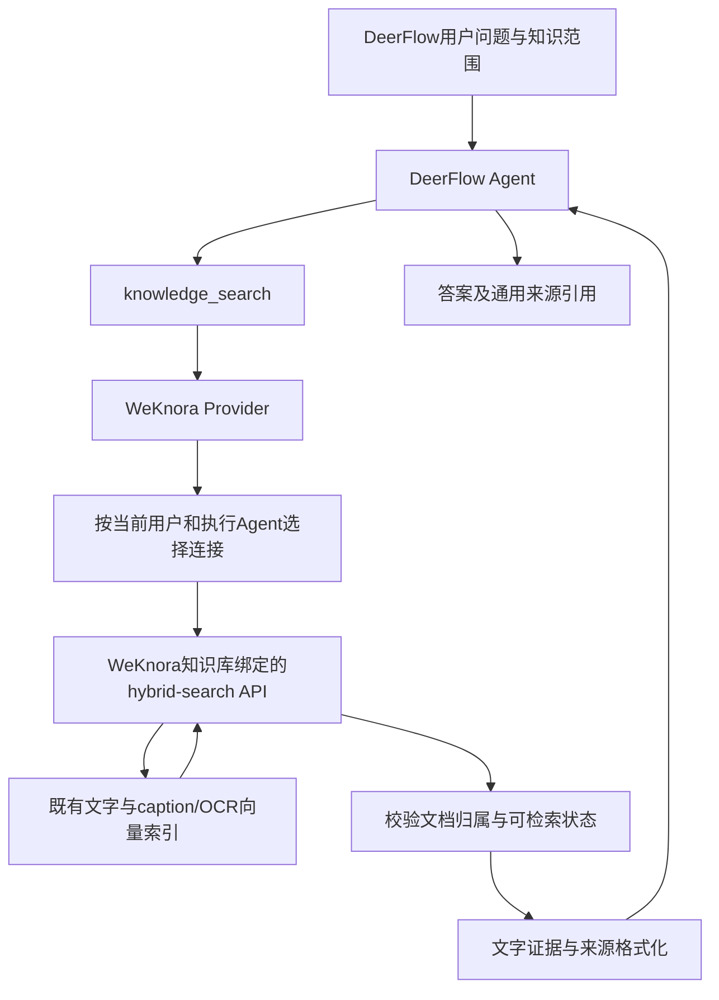
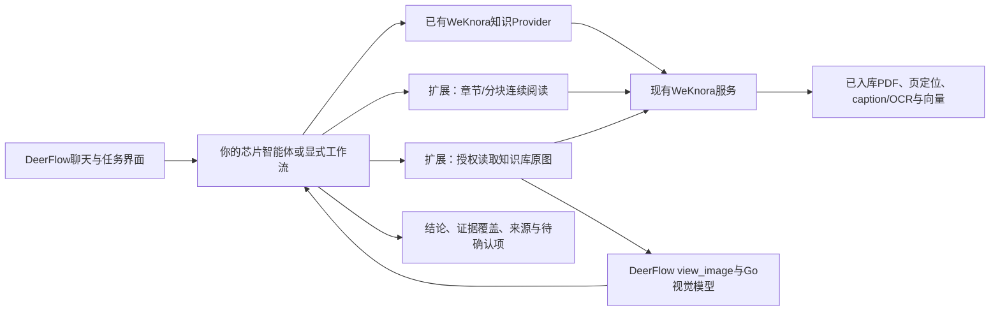

# DeerFlow 与 WeKnora 芯片知识问答对比分析

> 后续更新：DeerFlow现已在WSL Docker部署并完成实际网页验证，见[网页验收报告](deerflow-web-validation.md)。本文“未部署完整服务”的表述记录先期研究阶段；本轮通过现有WeKnora MCP工具补齐了连续阅读，不再局限于Provider单轮检索。

研究日期：2026-11-01。研究对象是 ByteDance 的 [bytedance/deer-flow](https://github.com/bytedance/deer-flow)，不是其它同名项目。源码固定在 `35656d6a9fe2ac76ddcf40335ede7361504ddf5b`，提交时间为2026-11-01 08:08:08（Asia/Shanghai）。本地 `deerflow/` 为该提交的稀疏检出，包含后端、契约及WeKnora扩展等研究文件；不是已部署的完整DeerFlow服务。

## 1. 结论

**DeerFlow能够支持知识问答，也适合作为自定义智能体的执行与交互平台；最直接的路线是 DeerFlow 负责智能体，WeKnora 继续负责手册解析、图片处理、索引和知识管理。** 当前上游已有可独立安装的WeKnora知识扩展，不必先自行直连SQLite或重做文档库。

但“可以连接知识库”和“已经实现与当前WeKnora相同的芯片问答体验”是两件事。本轮实际观察：

- 原有WeKnora适配器能够连接当前v0.9.0实例，列出两个知识库，识别10份芯片手册及1749页STM32手册，完成按库/按文档检索。
- 通过原有适配器、原有证据格式化函数和真实OpenCode Go模型调用，普通参数问答正确，带可解析的来源链接。
- 同一条单轮取证链对电路连线、时序折行和千页跨章节问题没有全部答出，尚不能视为等价替换。
- 原有适配器主要转交文字证据，未转交当前WeKnora的原图信息、PDF页码/区域定位，也没有提供与WeKnora研读工具等同的连续分块阅读接口。

因此，更合适的选择是**组合使用并补齐证据读取能力**。若只需要一般文本知识问答，已有扩展是可用起点；若要求原图核验、PDF定位及千页跨章节取证，需要增加相应工具与映射，并做完整智能体和网页验收。

## 2. 本轮完成范围

已完成：自定义智能体集成方案报告、原项目下移一层、服务恢复验证、DeerFlow官方资料与源码分析、原有Provider对真实知识库的兼容性检查，以及四类真实检索证据的单轮模型问答。

未实施：DeerFlow Gateway/前端部署、完整自主Agent循环、浏览器聊天验收、WeKnora外部执行器改造。以下实测不能被描述为完整DeerFlow产品已经跑通。上游自己的验证记录也区分Provider/ToolNode检查、生成答案质量和浏览器验收；本文仅把本机实际执行的检查算作本机结果。[上游验证记录](https://github.com/bytedance/deer-flow/blob/35656d6a9fe2ac76ddcf40335ede7361504ddf5b/examples/deerflow-extension-weknora/VALIDATION.md)

项目目录现为：

```text
chatbot/
├── README.md
├── weknora/                 原项目整体，含源码、配置、数据手册和私有运行环境
│   ├── WeKnora/
│   ├── docs/
│   ├── evidence/
│   ├── datasheets/
│   ├── .local/
│   ├── compose.yaml
│   ├── start.sh
│   └── stop.sh
├── deerflow/                固定提交的上游源码研究检出
└── reports/                 本报告及跨项目验证证据
```

网页仍是 http://localhost:18088 ，账号和数据库卷不变。迁移后执行了启动、前端代理登录、实际向量检索及容器健康检查；原有WeKnora源码工作区保持干净。Python虚拟环境入口中原目录路径已随迁移调整，业务代码未修改。证据为 `weknora/evidence/directory-migration.json`。

## 3. 两个系统的职责差异

当前DeerFlow以LangGraph和LangChain Agent构建执行循环，Gateway承担会话、运行、流式事件和附件等服务，Next.js提供交互界面。工具、子智能体、MCP、Skills、记忆及沙箱是其主要扩展面。它更适合围绕任务执行组织能力。[后端架构](https://github.com/bytedance/deer-flow/blob/35656d6a9fe2ac76ddcf40335ede7361504ddf5b/backend/docs/ARCHITECTURE.md)

WeKnora则已经把本文所需的文档上传、解析、分块、图片处理、向量索引、知识库管理、引用定位与问答组织成一条可运行链。它也有智能推理与工具扩展，因此不能简单说WeKnora只有RAG、DeerFlow才有Agent。两者主要区别是默认产品与扩展重心。

| 维度 | 当前WeKnora部署 | 当前DeerFlow源码及组合能力 |
| --- | --- | --- |
| 主要入口 | 知识库、文档、助手和引用问答 | 聊天任务、工具执行、子智能体、文件与运行状态 |
| 文档处理 | 官方DocReader，PDF正文、定位、位图与矢量图 | 会话文件与可选文档转换；知识库解析由外部Provider承担 |
| 持久知识索引 | 已有SQLite/sqlite-vec及BGE文字向量 | 不因上传附件就自动形成同等索引；可接RAGFlow、LightRAG、WeKnora等 |
| 一般问答 | 现有快速RAG已验证 | 配置knowledge_search后，可由Agent取证回答 |
| 多步研读 | 原生list_documents/read_document，已做跨章节实测 | 可多轮调用检索工具、委派任务；具体章节读取能力依工具而定 |
| 图片 | 已处理77张图，可上传图像直接核验 | 有view_image及视觉中间件；WeKnora只读Provider没有自动送原图 |
| 引用 | 分块、文档、PDF页码及区域定位 | 通用标题/摘录来源契约；WeKnora适配器当前不映射PDF定位 |
| 自定义执行 | 提示词、工具、MCP；替换整个执行器需适配 | 自定义Agent、子Agent、工具、Middleware和插件扩展；不是仅靠SOUL就任意替换所有运行语义 |
| 知识管理 | 已有完整使用界面与处理流程 | 有可选管理/平台插件，仍将解析索引委托给上游，不等同自带DocReader |

DeerFlow的SQL持久化、会话记忆和知识索引应区分：保存线程、运行、事件或用户偏好，不意味着已经建立了PDF分块检索库。

## 4. DeerFlow如何实现知识问答

### 4.1 已有的通用知识契约

`deerflow.knowledge`定义Provider、检索结果、来源、可选目录与过滤能力。Agent通过`knowledge_search`取得证据，再结合模型生成回答；Provider负责实际访问上游服务。数据集/文档选择需要Provider明确支持对应能力，不能仅靠界面显示一个选择框就假定已约束检索。[知识契约](https://github.com/bytedance/deer-flow/blob/35656d6a9fe2ac76ddcf40335ede7361504ddf5b/backend/docs/KNOWLEDGE.md)

WeKnora适配器已经实现知识库目录、文档目录、知识库过滤、文档过滤、检索和来源归属。它还具有按库检索已发布Wiki条目的可选方法，但不支持将Wiki页面严格过滤到指定原始文档，也没有声称支持实体关系检索。

当前本机知识库未启用Wiki或图谱，因此这些可选能力不计入本轮成功项。

### 4.2 已有WeKnora扩展的调用链



适配器通过`X-API-Key`和`X-Tenant-ID`访问上游；使用按知识库绑定的检索接口和可选`knowledge_ids`，没有直接读取SQLite。返回文档还要经详情接口校验归属和状态。用户、Agent与凭据的绑定由操作者配置，不是从模型参数推断。[扩展说明](https://github.com/bytedance/deer-flow/blob/35656d6a9fe2ac76ddcf40335ede7361504ddf5b/examples/deerflow-extension-weknora/README.md)

这套设计可以保留现有上传和索引成果，同时让DeerFlow拥有自己的对话执行器；不需要先把DeerFlow塞进WeKnora的后端。

### 4.3 信息在适配边界的变化

当前Provider的`search_scoped`发送`skip_context_enrichment=true`，取回命中分块后构建`RetrievalHit`。它映射content、标题、知识库名称及score，未映射image_info、source_locators、原始chunk_id等字段到通用来源。[Provider源码](https://github.com/bytedance/deer-flow/blob/35656d6a9fe2ac76ddcf40335ede7361504ddf5b/examples/deerflow-extension-weknora/deerflow_extension_weknora/provider.py#L202)

因此有以下区别：

- 按文档限定检索已经具备，但返回命中块不等于沿着章节连续阅读。
- caption/OCR作为文字可以被检索到，原图不会因此自动进入视觉上下文。
- 通用来源能展示标题和摘录，但无法仅凭现有映射恢复原生PDF高亮。
- 适配器声明验证的上游是v0.8.3。当前v0.9.0响应已经具有source_locators，本轮确认基础访问兼容，但适配器不会自动利用新增字段。

原生通用格式化函数默认每个命中最多800字符、总计8000字符，超出总预算时整体舍弃后续命中，并同步保留实际展示证据的来源。当前通用`knowledge_search`调用未传入其它预算值。这个默认值适合控制工具输出，但可能截断图面描述或长表的关键后半段；模型1M上下文并不能补回此前已截掉的证据。[来源格式化](https://github.com/bytedance/deer-flow/blob/35656d6a9fe2ac76ddcf40335ede7361504ddf5b/backend/packages/harness/deerflow/knowledge/sources.py#L67)、[工具入口](https://github.com/bytedance/deer-flow/blob/35656d6a9fe2ac76ddcf40335ede7361504ddf5b/backend/packages/harness/deerflow/knowledge/tools.py)

## 5. 当前实例的真实兼容性与问答检查

### 5.1 检查方法

使用Git固定提交中未修改的Provider/config、实际Knowledge契约和scope模块，直接执行catalog、documents、search_scoped方法。为了不部署整套应用，导入隔离了包初始化；没有执行Gateway、完整ToolNode、自主Agent循环或浏览器。

在现有WeKnora中创建临时、仅retrieve能力、仅允许两个目标知识库的API Key；检查完成后已撤销。没有重传、删除或重新解析文档，也没有更改模型、知识库策略和既有助手。

随后使用实际`format_result`默认预算格式化检索证据，调用现有OpenCode Go `deepseek-v4.1-flash`完成四组单轮问答。没有为提升结果手工挑选目标分块或替换它的证据内容；千页问题合并了两次中文子问题检索的结果。模型调用关闭thinking，并要求证据不足时明确说明。

这证明的是“原适配器真实取证＋原格式化＋真实模型”的可行性和局限，不是完整DeerFlow产品的端到端验收，也不是两套完整Agent的公平性能排名。

### 5.2 接口与边界结果

| 检查 | 本机结果 |
| --- | --- |
| 列出授权知识库 | 2个 |
| 列出芯片手册 | 10份 |
| 列出RM0090千页样本 | 1份，沿用已入库的1749页样本 |
| 按指定文档检索 | 七组查询均返回12个命中 |
| 未绑定用户访问 | PermissionError，被拒绝 |
| 将其它库的文档放进当前库选择 | PermissionError，被拒绝 |
| 来源中的页码 | 此适配路径未映射，未返回有效页码 |
| 临时凭据 | 已撤销 |

七组查询为：普通参数、电路、时序、两组英文千页查询及两组中文千页查询。命中数量只表示访问与映射成功，不代表命中内容相关或答案完整。

证据：`reports/evidence/deerflow-provider-live.json`。

### 5.3 实际答案质量

| 问题 | 本轮结果 | 与既有WeKnora验证的差别 |
| --- | --- | --- |
| CH340C是否需要晶振；5V/3.3V时V3连接 | 正确：无需外部晶振；5V时V3接0.1μF退耦，3.3V时V3与VCC相连；带来源链接 | 普通参数问答能力已具备 |
| 第7页7.2节U4/U5、晶振、电容、TXD至DB9 | 型号和器件值正确；具体发送引脚链路明确表示无法确认，还复述了原caption中的转写错误 | 未达到此前原图上传和原生RAG该样本的完整结果 |
| Figure16命令、地址、dummy、首字节、片选续行 | 地址、dummy、高阻正确；首字节完整时钟范围及上下行是否连续表示证据不足 | 尚未达到此前视觉核验及原生RAG该样本的完整结果 |
| RM0090的DMA2/SDIO映射与DMAEN/DPSM跨章节 | 缺少目标映射表和寄存器完整证据，明确回答无法确定 | 两次检索不足以替代此前原生研读助手的逐段取证 |

普通参数回答约6.1秒；电路约5.8秒；时序约6.5秒；千页约7.9秒。此时间仅为相应单轮上游模型请求，不能与完整Agent任务耗时直接比较。四次均为正常stop结束，没有输出截断。

电路/时序的证据里已有自动图像描述和OCR，模型不是在这次调用中直接看原图。caption本身存在引脚名称和连线转写错误，这属于现有入库证据质量问题，不能全部归因于DeerFlow。要求模型保守回答减少了无证据补全，但不会自动提高检索覆盖。

千页初始的两条英文查询在**当前本地embedding部署**中实际产生相同向量，进而返回相同结果。改为中文完整问题后召回出现SDIO/DMA章节，但仍缺少完整目标证据。该观察不能推广成BGE所有版本都不支持英文，也不能认定是DeerFlow错误；根因尚未定位。若继续部署，应检查本地模型/Tokenizer一致性及中英检索效果，再决定是否更换多语言embedding并重建索引。

证据：`deerflow-generation-probe.json`、各`deerflow-*-formatted.json`和`current-embedding-probe.json`。来源链接格式已生成，但DeerFlow网页展示和点击跳转本轮未验证。

## 6. 图片、电路图与时序图能否达到相同能力

### 6.1 DeerFlow本身具备视觉路径

DeerFlow有`view_image`工具及`ViewImageMiddleware`。工具读取线程沙箱允许范围内的图片，视觉中间件在后续模型请求中注入图片数据；模型必须真实支持视觉。当前实现对图片数和体积设置上限，并不把全部图片永远保存在每次模型上下文里。[看图工具](https://github.com/bytedance/deer-flow/blob/35656d6a9fe2ac76ddcf40335ede7361504ddf5b/backend/packages/harness/deerflow/tools/builtins/view_image_tool.py)、[视觉中间件](https://github.com/bytedance/deer-flow/blob/35656d6a9fe2ac76ddcf40335ede7361504ddf5b/backend/packages/harness/deerflow/agents/middlewares/view_image_middleware.py)

因此，用DeerFlow上传芯片电路/时序图片，再调用视觉模型，从架构上可实现。当前Go账户的该模型已有WeKnora图片调用实测，但它在DeerFlow模型配置、工具读取、图片注入及界面中的完整行为仍需验收。示例配置中其它DeepSeek型号的vision注释不应覆盖我们实际调用的Go模型能力。

### 6.2 缺少的是知识命中与原图读取的连接

当前WeKnora扩展没有把命中的图片资源搬入线程沙箱，也未提供一个读取命中原图的工具。`resource://`不是可直接交给外部模型访问的HTTP链接。仅开启DeerFlow的supports_vision不会补上这一环。

要形成与当前WeKnora图文助手相近的能力，可增加一个受授权约束的工具：根据已授权的文档/分块证据定位图片 → 从WeKnora读取原图 → 写入当前线程允许的文件位置 → 调用view_image → 对图面与文字证据交叉核对。返回图的身份及其来源，不能由模型任意拼装本地路径或猜页码。

若用户直接上传目标图片，可以先走已有视觉路径，不必等待知识库原图桥接。但这和“只问文字，系统从知识库自动找到并看原图”仍是不同验收项。

### 6.3 扫描件与PDF附件不能自动等同于图片知识库

DeerFlow支持会话附件，并有可选PDF/Office转Markdown实现。当前示例`uploads.auto_convert_documents=false`；开启后PDF可优先尝试pymupdf4llm，失败或文本稀疏时回退MarkItDown。调用普通转换器不等于已运行专门OCR、矢量图提取或图片索引。[附件配置](https://github.com/bytedance/deer-flow/blob/35656d6a9fe2ac76ddcf40335ede7361504ddf5b/config.example.yaml#L1689)、[转换实现](https://github.com/bytedance/deer-flow/blob/35656d6a9fe2ac76ddcf40335ede7361504ddf5b/backend/packages/harness/deerflow/utils/file_conversion.py)

现有WeKnora已经完成77张图的描述/OCR及资源存储。组合路线可以继续使用这些成果，无需因选择DeerFlow就重新从PDF附件开始。

## 7. 千页手册、跨页与跨章节如何实现

### 7.1 三种策略

| 策略 | 实现 | 局限 |
| --- | --- | --- |
| 附件转Markdown后用文件工具阅读 | 上传手册、可选转换、按段读取/搜索 | 不自动拥有向量库、PDF区域定位和全图OCR；读取成本与布局丢失需验证 |
| DeerFlow调用外部知识Provider | 复用WeKnora索引，分解问题并反复搜索 | 默认检索预算和召回覆盖可能漏掉章节；当前适配器不连续读分块 |
| 检索定位＋章节连续阅读＋必要原图核验 | 增加read_document/read_chunk_window和图像读取工具，由Agent或显式工作流组织 | 最接近当前研读与视觉能力，需要扩展及端到端验证 |

推荐第三种用于芯片手册。先按型号/版本/文档范围确定对象，再拆成章节子问题，取得映射表、寄存器定义、流程要求各自证据；缺失则继续读邻块或章节。最终汇总时保留每一结论依赖的来源，并标明推断与未确认项。

### 7.2 分页支持的具体含义

跨页支持依赖解析后正文及引用定位、分块边界和邻近阅读，而不是模型上下文够大就自动解决。跨页表格可能把列头和数据行拆开；时序图可能在上下行重复时钟；寄存器表和使用说明可能相隔数百页。

现有WeKnora已经有父子分块、页定位和原生研读工具。DeerFlow原始WeKnoraProvider关闭上下文补全，且只提供搜索类证据，不会自动读取缺失的邻页。可以通过工具扩展补齐，但不能用“支持子智能体”代替章节读取能力。

### 7.3 多章节关联与子智能体

DeerFlow可以把电气参数、电路图和时序分配给不同子任务，再汇总来源。子任务共享已授权的知识范围与凭据可见性，不能因委派而扩大权限。跨任务引用还受来源转交及输出预算约束。通用契约支持普通委派的来源保留，但不要默认所有持久批任务路径具有完全相同覆盖。

对子智能体的最终要求应是“提供具体结论和可核验来源”，而不是仅返回自然语言总结。结果不一致时要回查原文。当前两条英文查询向量相同的现象也说明，增加更多Agent不能自动修复底层召回问题。

## 8. 自定义智能体能力与开发边界

DeerFlow的Custom Agent配置包括模型、工具组、Skills、MCP、默认知识范围、可调用子智能体和记忆等；SOUL及提示配置改变职责和行为。部署侧可配置自定义子Agent及中间件，并可通过独立插件贡献工具等能力。[Agent配置](https://github.com/bytedance/deer-flow/blob/35656d6a9fe2ac76ddcf40335ede7361504ddf5b/backend/packages/harness/deerflow/config/agents_config.py#L207)、[子Agent配置](https://github.com/bytedance/deer-flow/blob/35656d6a9fe2ac76ddcf40335ede7361504ddf5b/backend/packages/harness/deerflow/subagents/config.py)

不过，配置一个新Agent仍然使用已有Lead/子Agent执行语义。若你的要求是严格按固定业务节点执行、结果不满足规则就循环补查、特定节点等待人工确认，应使用明确的编排实现，而不是只写一段提示词。

当前上游另有可选Script workflows扩展，通过脚本编排公开AgentRuns能力，并具备进度、检查点等机制；这可作为芯片审查流程的候选，但需要单独安装及验收，不属于默认启用能力。[工作流扩展](https://github.com/bytedance/deer-flow/blob/35656d6a9fe2ac76ddcf40335ede7361504ddf5b/examples/deerflow-extension-workflows/README.md)

相对“改造WeKnora聊天入口以接外部执行器”，采用DeerFlow前台与执行层、WeKnora知识后端，可以直接利用已有Provider。若必须保留WeKnora网页，就仍需上一个报告中的外部执行适配，不能因为选择DeerFlow而省略SSE、取消、消息存储及引用转换。

## 9. 知识管理插件的现状

不能笼统说DeerFlow完全没有知识管理扩展。当前上游还包括可选的knowledge-management与knowledge-platform包：前者可将文件/URL/手工文档入库、状态查询、重处理、取消等操作转交给WeKnora；后者增加连接与逻辑空间策略。它们仍依赖上游解析、模型和索引，不会安装自己的DocReader或embedding库。

这两个包并不因为安装就提供完整知识中心页面；平台策略也不会自动接管现有聊天检索权限。检索绑定、管理授权和空间策略分别配置。初始管理路径还有管理员和显式资源授权等条件，不能简单视为通用组织知识平台已经全部就绪。[管理扩展](https://github.com/bytedance/deer-flow/blob/35656d6a9fe2ac76ddcf40335ede7361504ddf5b/examples/deerflow-extension-knowledge-management/README.md)、[平台扩展](https://github.com/bytedance/deer-flow/blob/35656d6a9fe2ac76ddcf40335ede7361504ddf5b/examples/deerflow-extension-knowledge-platform/README.md)

当前知识管理文件上传扩展上限为16MiB，默认会话附件单文件限制为50MiB，WeKnora DocReader本地配置也有自己的50MB上限。它们是不同入口的限制，不应混用；千页文件是否可用应依据实际文件体积及具体路径确认。本轮未调用这些管理扩展写入数据。

## 10. 建议架构与后续验收



建议按以下次序推进，不需要改动当前WeKnora业务源码：

1. 部署DeerFlow到独立端口，配置Go模型和已有只读Provider，保持原WeKnora服务继续运行。先验证登录、知识范围选择、普通问答及刷新后的来源展示。
2. 评估并修复当前本地embedding对英文查询退化的问题；用中文/英文/混合术语做检索基准。更换embedding时重建相应索引，不混用不同向量模型。
3. 用独立扩展增加文档连续阅读、原图读取和当前source_locators映射，避免修改核心执行循环。按需扩展证据预算；仅提高模型上下文上限不够。
4. 明确芯片流程：问题拆分→分别取证→检查缺项→补读章节→核验原图→冲突检查→带引用输出。严格流程用显式编排，普通任务可用Agent自主循环。
5. 逐项复跑既有验收题：CH340供电、电路的型号/器件/连线、W25时序的dummy/数据/片选、RM0090 DMA/SDIO跨章节。检查正确性、证据覆盖和实际引用，而不只检查返回200。

验收至少包括：受限知识范围不越界；正确来源随对话重放；图片传给视觉模型而非只读描述；跨页表格上下文完整；停止按钮中止后续任务；长任务状态真实；错误不被包装成成功。本轮这些后续事项是实施建议，未宣称已经完成。

## 11. 证据索引

| 文件 | 内容 |
| --- | --- |
| `weknora/docs/custom-agent-integration.md` | WeKnora内集成自定义智能体的两级方案 |
| `weknora/evidence/directory-migration.json` | 迁移后的登录、检索、容器与源码状态 |
| `reports/evidence/deerflow-provider-live.json` | 真实Provider目录、七组检索、边界拒绝和临时Key撤销 |
| `reports/evidence/deerflow-generation-probe.json` | 四组真实Go单轮问答与明确的方法边界 |
| `reports/evidence/deerflow-*-formatted.json` | 原生默认预算后的实际文字与来源 |
| `reports/evidence/current-embedding-probe.json` | 当前本地查询向量退化观察 |
| `weknora/docs/vision-qa-validation.md` | 先前WeKnora的原图与入库图片问答验收 |
| `weknora/docs/knowledge-qa-analysis.md` | 先前跨页、跨章节及1749页研读验收 |

研究与验证没有修改WeKnora或DeerFlow上游源码。所有模型与知识库密钥保持在私有运行目录或进程中，未写入报告及公开证据。
