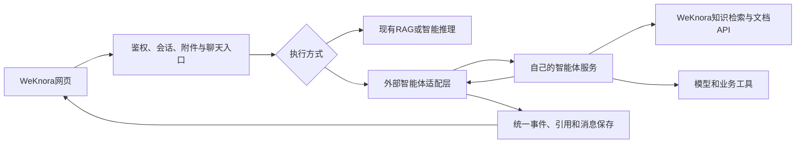

# WeKnora 自定义智能体集成方案

日期：2026-11-01。目标是继续使用 WeKnora 的网页、会话、附件及现有芯片知识库，同时由自定义智能体控制问题拆解、检索、视觉核验和最终输出。

## 结论

可以分两级集成：通过 MCP 把外部智能体作为工具交给现有助手调用，不需要修改 WeKnora；或者增加外部执行器，由自己的智能体接管整个对话流程。后者通常需要后端适配，不能只填写一个外部 Agent URL 完成。目前未实施执行器改造，此前不改代码的部署状态保持不变。

## 两种路径

| 项目 | MCP工具接入 | 外部执行器接入 |
| --- | --- | --- |
| 用户入口 | WeKnora现有聊天界面 | WeKnora现有聊天界面 |
| 外层规划 | WeKnora智能推理助手 | 自己的智能体 |
| 外部服务职责 | 一次专业任务或完整业务子流程 | 整轮规划、工具执行、补查、回答 |
| 是否改WeKnora | 现有配置即可接入 | 通常需要增加执行分支与事件适配 |
| 步骤展示 | 默认显示工具调用及结果，内部细节需额外接入 | 可映射为现有步骤，专用任务树可能需要前端改造 |
| 文档索引 | 继续使用WeKnora | 继续使用WeKnora |

当前部署的 `/api/v1/mcp-services` 管理入口已现场返回200。模型可以在智能推理模式中调用所选MCP服务；工具调用仍由外层执行器调度，提示词约束不等于强制替换执行引擎。

## 外部执行器架构



建议新增一种执行方式，保留已有助手与调用路径。自己的服务独立部署，WeKnora负责产品入口和知识管理，外部服务负责业务执行。

### 请求协议

外部请求至少包含：run_id、session_id、当前问题、明确允许的历史、附件资源引用、知识库/文档范围，以及可取消的执行上下文。身份和授权范围由服务器生成，不能信任模型生成的tenant_id或用户传入的任意资源ID。

建议的请求示意（不是项目现有外部执行接口）：

```json
{
  "run_id": "...",
  "session_id": "...",
  "query": "检查SPI连接与时序是否符合手册",
  "history": [],
  "attachments": [],
  "knowledge_scope": {
    "knowledge_base_ids": ["..."],
    "knowledge_ids": ["..."]
  }
}
```

### 事件协议

适配层将外部服务的事件转换为现有网页和消息存储理解的事件。可先定义step.started、tool.completed、answer.delta、citation、run.completed、run.failed和run.cancelled等语义，再逐一映射项目实际SSE协议。不能假定同名事件可以直接透传。

最终回答应有完整消息记录；断线、超时、取消不能留下虚假的完成状态。重试应使用run_id识别，防止重复工具操作或重复写入。

### 引用与图片

检索证据保留知识库ID、文档ID、分块ID、页码、区域定位及来源类型。不要只返回来源标题，否则无法可靠复用原生引用。结构化sources需要转换为项目实际引用格式并验证前端跳转。

图片附件及知识库图片通过授权资源机制读取；`resource://`不是可以直接交给第三方模型访问的公网URL。当前本地BGE为文本embedding，入库图片通过caption/OCR召回；关键图应由自定义流程显式读取并交给视觉模型核验。

### 知识API复用

| 用途 | 当前可用接口 |
| --- | --- |
| 知识检索 | POST /api/v1/knowledge-bases/{kb_id}/hybrid-search |
| 文档列表 | GET /api/v1/knowledge-bases/{kb_id}/knowledge |
| 文档分块 | GET /api/v1/chunks/{knowledge_id} |
| 指定分块 | GET /api/v1/chunks/by-id/{chunk_id} |
| 图片画廊 | GET /api/v1/knowledge-bases/{kb_id}/images |
| 原始文档预览 | GET /api/v1/knowledge/{knowledge_id}/preview |

hybrid-search接口已现场验证返回正文、image_caption、ID及source_locators。当前官方SQLite镜像缺FTS5，实际主要使用文字向量召回；接口名称不代表已启用关键词全文检索。分块列表缺省返回text，需要显式选择image_caption或image_ocr等类型。

## 芯片业务流程示例

识别芯片和版本 → 分拆供电/引脚/接口约束 → 分别检索参数、典型电路、时序 → 阅读相关章节及必要邻块 → 读取关键原图进行视觉核验 → 检查证据覆盖和冲突 → 补查缺项 → 输出参数、风险、待确认项及逐项引用。

跨章节关联由问题拆分、证据组织和流程控制完成，不能将检索到若干文本块视为已经证明电气连接或时序设计正确。可把文档取证与电气规则校验设计为不同步骤。

## 实施阶段与验收

第一阶段：增加外部执行配置和后端适配，仅实现文本流式回答、引用、鉴权范围、取消及消息保存。检查原有助手不受影响。

第二阶段：接入图片附件、知识库原图与工具步骤展示，使用已有人工作为基准的CH340电路和W25Q32时序测试；核验页码、引用资源和用户权限。

第三阶段：支持长任务恢复、幂等、任务状态、超时及可观测日志。以1749页RM0090跨章节任务检查证据覆盖，不以模型上下文上限替代检索和分页阅读。

本报告记录方案，不代表上述外部执行器已经实现。现有部署与图片问答验收见同目录 `vision-qa-validation.md`；跨页、跨章节和千页验证见 `knowledge-qa-analysis.md`。
