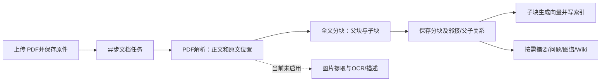

# WeKnora 芯片手册知识问答：运行验证与方案分析

> 后续更新：图片链路已通过原生配置跑通，见 [图片问答验证报告](vision-qa-validation.md)。本文第8节“未开启图片”、HTTP DocReader等描述记录的是本轮视觉配置之前的状态；当前已切换官方gRPC DocReader，启用Go视觉模型，并完成两份手册图像解析及问答。大文档/跨章节的原有验证仍有效。

核验时间：2026-11-01（Asia/Shanghai）。本轮仅使用原有 HTTP API 完成配置、重新解析和问答验证，没有修改 WeKnora 或本地适配服务的代码。新增内容是分析文档与证据文件。

## 1. 结论与使用方式

现在有三种可直接使用的配置，网页均为 <http://localhost:18088>：

| 助手 | 资料范围 | 适合的问题 | 实际工作方式 |
| --- | --- | --- | --- |
| 芯片手册助手 | 原有 10 份嘉立创 PDF | 单芯片参数、一般资料查询 | 原生快速 RAG：问题理解、向量召回、上下文补全、生成引用回答 |
| 芯片手册研读助手 | 原有 10 份嘉立创 PDF | 跨页、跨章节、多芯片对照 | 原生智能推理流程，调用 `list_documents` 与 `read_document` 分次取证 |
| STM32千页手册研读助手 | 新增的 1749 页 RM0090 验证库 | 大手册内的寄存器、外设和章节查阅 | 同一套原生研读工具，按文档与分块定位，不把整本手册塞给模型 |

可以在左侧“智能体”选择对应助手；本次验证对话也保存在会话列表中。原始 10 份资料未移走，千页样本单独建库。

文本知识问答、跨页和跨章节查阅已实测。当前部署不支持真实图片理解：图片输入被当前助手明确拒绝，文档图形也未被送入视觉处理。系统源码存在图片处理链，但不能把“代码中有能力”当成“此部署已启用”。

## 2. 验证依据与版本边界

- 运行后端：官方 `v0.9.0 / standard`，提交 `f17ee8a`，构建于 2026-10-29。见 [system-info.json](../evidence/analysis/system-info.json)。
- 工作区源码：`80e8345903ce4af970497de8359b8b4ea4ce4917`。源码工作区无修改。
- PDF 服务直接加载工作区的原生 `PDFParser`；Go 后端使用上述已固定镜像。因此，PDF 解析源码与 Go 运行版本不是同一提交。
- 本轮读取了运行提交，并核对关键文件差异，保存于 [source-runtime-differences.txt](../evidence/analysis/source-runtime-differences.txt)。新版源码新增的父块槽位聚合、以图片生成查询向量、HTTP 结果读取上限，**不作为当前镜像已经具备的保障**。核心父子分块、原生阅读工具和问答效果以运行实测为准。

RM0090 样本为 **2019-02、Rev 18、1749 页**，不是最新版保证。ST 官方参考入口为 [RM0090](https://www.st.com/resource/en/reference_manual/rm0090-stm32f4xx-reference-manual-stmicroelectronics.pdf)。官方及社区下载受限后，使用了公开 GitHub 镜像，核对封面和实际页数；下载来源与 SHA-256 见 [large-manual.json](../evidence/analysis/large-manual.json)。

## 3. 本轮通过配置做了什么

所有操作使用已有 `/api/v1` 接口，无新增业务处理逻辑：

1. 保存原知识库、模型与助手配置作为核验基线。
2. 用知识库 PATCH 接口启用自适应父子分块：`strategy=auto`、父块目标 4096 字符、子块目标 384 字符、父块重叠 120 字符，子块重叠由原生流程按约 20% 推导。`token_limit=400` 是子块的近似 token 预算；它不是模型上下文长度，也不是精确分词保证。
3. 用现有逐文档 `reparse` 接口重新处理原 10 份 PDF，全部完成。
4. 快速助手启用问题改写，召回候选设为 24、最终上限 12、回答上限 4096 token。字段名 `rerank_top_k` 在未配置重排模型时仍决定最终保留数量，不能因此认定发生了模型重排。
5. 新增原生研读助手，仅开放 `list_documents`、`read_document`。当前没有独立 rerank 模型；此运行版本中，自定义推理助手开放 `search_knowledge` 会要求配置 rerank 模型，因此没有虚设这一工具。研读助手实际使用的是文档内文字/正则匹配、顺序分页与邻块读取。
6. 将真实千页 RM0090 通过原生建库、上传、异步处理流程导入独立验证库，配置同样的父子分块。
7. 增加提示约束：本次检索未命中，不得据此断言知识库里不存在文档。

配置前后快照在 `evidence/analysis/*config.json`、`kb-final.json`、`agent-final.json`、`reading-agent-final.json`。

## 4. 文档入库：从 PDF 到可检索证据

### 4.1 原件与异步处理

上传接口先检查文件大小、保存原始文件和知识记录，再提交文档处理任务，不会在上传请求中等待所有向量完成。处理阶段分为 DocReader、chunking、embedding、multimodal、postprocess，可以从原生 stages 接口观察。当前是单实例、内存任务队列模式；原件、业务记录、分块和索引持久化在 Docker 数据卷中。内存队列与外置 Redis 多实例队列的可靠性和扩展方式不同。

入口参见 [knowledge.go](/home/caorui/workspace/xfusion/chatbot/weknora/WeKnora/internal/handler/knowledge.go:331)，处理逻辑见 [knowledge_process.go](/home/caorui/workspace/xfusion/chatbot/weknora/WeKnora/internal/application/service/knowledge_process.go:402)。

### 4.2 PDF 解析与页码

当前本地适配服务通过已有 HTTP DocReader 协议调用 WeKnora 的 `PDFParser`。原生解析器逐页读取 PDF：对文本页提取文字并尝试还原阅读顺序，对扫描页识别为图像页。随后把页面文字拼为全文，用 `source_blocks` 记录“全文字符区间 → 原始页码/区域”。

页边界保存在位置映射中，并没有把每页强制变成一个独立检索单元。所以，一段内容可以跨页；一个后续父块也能覆盖多页。**页码定位是证据定位能力，不是语义推理能力。**

参见 [PDFParser](/home/caorui/workspace/xfusion/chatbot/weknora/WeKnora/docreader/parser/pdf_parser.py:2313) 及其 [全文拼接与 source_blocks](/home/caorui/workspace/xfusion/chatbot/weknora/WeKnora/docreader/parser/pdf_parser.py:2420)。

### 4.3 自适应与父子分块

`auto` 根据文档画像选择标题、启发式或递归分块，失败会回退。标题识别成功时，章节面包屑可加到索引内容中，帮助同名参数区分章节。但 PDF 的视觉标题不一定能转成可靠的 Markdown 层级，不能假定每本手册都会自动形成完整章节树。

当前父块约 4096 字符，子块约 384 字符；都是目标大小，保护表格、链接等结构后，实际长度可能略有变化。父块保存较大上下文，子块进入向量检索。子块带 `ParentChunkID`，块间还有 `PreChunkID/NextChunkID`。原文偏移保持在正文坐标中，章节上下文用于索引时不会改变原文位置。

原生配置推导明确把 token 预算放在子块，父块保留较大的字符预算，见 [DeriveParentChildConfigs](/home/caorui/workspace/xfusion/chatbot/weknora/WeKnora/internal/infrastructure/chunker/strategy.go:230)。落库及索引见 [knowledge_process.go](/home/caorui/workspace/xfusion/chatbot/weknora/WeKnora/internal/application/service/knowledge_process.go:597)。

本次实际读到一个 CH340C 父块，类型为 `parent_text`，**4057 字符，覆盖 PDF 第 3、4、5 页**。见 [CH340C-parent.json](../evidence/analysis/CH340C-parent.json)。这证明跨页上下文确实已经进入当前数据，而不是仅打开了一个未生效的开关。

### 4.4 向量索引

当前使用 WSL CPU 本地 `BAAI/bge-small-zh-v1.5`，每个子块映射为 512 维向量。它的输入长度上限为 512 token；标题、章节路径等也占输入预算，超长内容会被向量模型截断。因此“小子块用于定位，大父块用于回答”更适合当前模型。

SQLite 的 sqlite-vec 保存向量并按 cosine 距离检索。FTS5 在当前官方 app 镜像中不可用，尽管配置和能力接口可能仍显示 `keyword=true`，本部署实际没有可用的关键词全文召回。这里的“hybrid-search”接口名称不等于真正运行了向量+BM25双路混检。

批量索引使用窗口和分批写入，避免一次持有全部生成向量。当前对应实现每批 40、窗口 200；见 [索引服务](/home/caorui/workspace/xfusion/chatbot/weknora/WeKnora/internal/application/service/retriever/keywords_vector_hybrid_indexer.go:96)。

## 5. 普通知识问答如何产生答案

原生 RAG 管道包含：加载历史、记忆召回、问题理解、并行检索、重排阶段、合并、Top-K、组装消息、流式生成。阶段存在不意味着一定执行相应能力：没有 rerank 模型就跳过模型重排，图谱未启用就没有图谱路径，当前查询扩展开关也不能凭空补上失效的 FTS5。

参见 [管道装配](/home/caorui/workspace/xfusion/chatbot/weknora/WeKnora/internal/application/service/session_knowledge_qa.go:190)、[重排缺省处理](/home/caorui/workspace/xfusion/chatbot/weknora/WeKnora/internal/application/service/chat_pipeline/rerank.go:65)、[合并流程](/home/caorui/workspace/xfusion/chatbot/weknora/WeKnora/internal/application/service/chat_pipeline/merge.go:33)。

生成模型看到的是本轮选中的证据与有限历史，不是整本 PDF。它需要在证据中综合数值、条件和型号，再返回引用。引用附着到具体来源分块及其定位；前端再打开 PDF 并高亮。合并后的大上下文用于帮助理解，引用仍应回到原始证据片段。参见 [citation_sources.go](/home/caorui/workspace/xfusion/chatbot/weknora/WeKnora/internal/application/service/chat_pipeline/citation_sources.go:12) 与 [来源预览组件](/home/caorui/workspace/xfusion/chatbot/weknora/WeKnora/frontend/src/components/ChatReferenceSourceView.vue:212)。

## 6. 跨页、跨章节、跨文档是三类不同问题

### 6.1 相邻跨页

已有五种支撑：全文串联、块间重叠、父子块关系、前后块关系、页码映射。检索命中子块后可回捞较大的父块；合并阶段也会合并相邻/重叠片段，并对短于 350 字符的短上下文尝试邻块扩充（约 850 字符预算）。它不是对每次命中无限向前后翻页。

分页处的句子若在同一父块，或相邻片段都被召回，就可共同用于回答。若是跨页复杂表格，则仍依赖解析器是否正确保留列、单位、表头和脚注；字符串拼接不等于表格结构重建。

### 6.2 远距离跨章节

“电气特性”“时钟”“通信接口”相隔几十页，不能依靠 120 字符重叠连接。需要：

- 不同相关章节各自命中检索；
- 标题/路径帮助识别片段语境（前提是识别成功）；
- 模型拿到多处证据后综合；
- 不足时用阅读工具再定位缺失概念，读取其周围分块。

系统不会因为文中写了“见第 12 章”就保证自动追踪该章，也不会自动建立任意两个章节的完整因果关系。图谱与 Wiki 是额外已有方案，但当前均未启用；父块也不等于知识图谱。

### 6.3 原生研读循环

研读助手先列出文档，再用 `read_document` 在特定文档中寻找短词或正则，或用 chunk 句柄读取前后文，随后针对新出现的术语继续读。工具原生支持：

- 文档内顺序分页：`offset/limit/next_offset`；offset 是阅读顺序中的分块位置，不是 PDF 页码。
- 文档内查询：默认按空白分词，要求这些词同时出现；英文手册用长中文查询会失败。
- 正则查询与命中片段附近上下文。
- 指定片段读取左右邻块，`context` 最大为 5。
- 默认每次 20 个块、上限 100，但输出预算可能让实际返回更少；应继续 `next_offset`，而非认定已读完。

参见 [read_document.go](/home/caorui/workspace/xfusion/chatbot/weknora/WeKnora/internal/agent/tools/read_document.go:16)。

该方案把“关联”放在**多次有目标取证 + 模型综合**里，适合多章节问题；它仍受工具轮数、输出预算、术语选择和模型判断影响，不保证穷尽整本书。

## 7. 本次问答的正反例

| 验证 | 实际结果 | 证据边界 |
| --- | --- | --- |
| CH340C 晶振、V3供电、串口速率跨页问题 | 完整回答、未截断；约13秒 | 引用片段覆盖PDF第1–6页，不意味着模型读遍每一页 |
| 快速RAG比较CH340C与FT232RL | **漏召回FT232RL**，错误地说没有其手册 | 不能作为跨文档能力全通过；已追加提示禁止把“没命中”说成“不存在” |
| 原生研读比较同一对芯片 | 列出两份文档后分别读，得到CH340C 2Mbps、FT232RL最高3Mbaud及内部时钟说明；约23秒 | 成功补齐快速RAG缺失，引用覆盖两个文档；附RS232速率条件，不能把所有接口电平都当3Mbaud |
| ESP32-C3多章节参数 | CPU 160MHz、电源推荐范围3.0–3.6V、Deep-sleep 5µA等分别取证；约40秒 | 引用片段覆盖第29、34、50、52、53页；有关跨表格脚注仍需核对，不能只因有引用就认为每句附加解释均无误 |
| 直接上传手册电路图提问 | HTTP 400：`Image upload is not enabled for this agent` | 当前配置明确未开放图片输入，不能称为已支持 |

原始流式事件、查询、工具调用与答案保存于 `evidence/analysis/`；引用页码见 [citation-pages.json](../evidence/analysis/citation-pages.json)。这些是少量代表样例，不是召回率或准确率统计评测。

## 8. 图片问答：原方案支持哪些路径，当前缺什么

需要区分三件事：

1. **在网页中看到PDF里的图片**：浏览器展示原始PDF，不依赖视觉模型；当前已支持。
2. **用文字问文档中的图表/电路**：先从PDF提取图片，保存原图，再做OCR/描述，形成可检索内容并与正文父块关联。支持图片输入的对话模型也可结合命中原图。若只有文本模型，往往依靠图像的描述/OCR间接回答。
3. **上传一张图片提问**：助手必须允许图片上传，并配置可接受图片的对话模型或独立VLM。问题理解阶段用视觉模型生成图像描述/检索问题，再走检索和回答；纯文本模型不能通过改一个名称就获得视觉能力。

原生代码入口见 [图片输入校验](/home/caorui/workspace/xfusion/chatbot/weknora/WeKnora/internal/handler/session/qa.go:340)、[视觉模型选择](/home/caorui/workspace/xfusion/chatbot/weknora/WeKnora/internal/application/service/chat_pipeline/query_understand.go:234)、[图片处理任务](/home/caorui/workspace/xfusion/chatbot/weknora/WeKnora/internal/application/service/image_multimodal.go:80)。

当前缺口是连续的：

- 助手 `image_upload_enabled=false`，未配 `vlm_model_id`；对话模型登记 `supports_vision=false`。
- 本地BGE是文本向量模型，不是图片向量模型。
- 原有PDF适配服务设置不提取嵌入图片，而且返回 `image_refs=[]`。所以仅打开知识库的图片开关不能补回被丢掉的图片。
- 多模态、OCR和图片索引未运行；扫描页可能只有图片占位符，不能保证从扫描手册读到文字。

若要不改业务代码地启用，需要切换到项目**已有的完整DocReader部署**或其它已有解析引擎，配置真实可用的视觉模型与存储，打开知识库/助手对应选项，并重新解析。图片向量检索还需兼容的多模态embedding模型，是另一项可选条件。最新版源码中的以图生成查询向量能力，不能直接归到当前f17镜像。

电路图中“看到了线和标号”也不等于电气连接已被严格还原；时序图、单位、坐标和细小脚注均需单独验收。本轮没有配置视觉模型，因此没有声称通过图像识别测试。

## 9. 千页芯片手册的真实入库结果

本次上传的是完整1749页PDF，28,221,774字节（约26.9MiB），不是重复短文拼出的样本。原生处理完成：

| 阶段 | 实测 |
| --- | --- |
| DocReader | 66.717秒，输出约342万字符；当前图片返回数为0 |
| 分块 | 0.433秒，写入13,674个父/子文本块 |
| 父块 | 1,091个 |
| 可检索子块 | 12,583个 |
| 向量索引 | 126.517秒 |
| 主处理总计 | 195.607秒，约3分16秒；摘要为另行任务 |
| 状态 | completed；原生图像处理阶段skipped |

见 [large-stages.json](../evidence/analysis/large-stages.json) 与 [large-status.json](../evidence/analysis/large-status.json)。阶段报告中的总文本量包含父块、子块和重叠，不能误当作原手册唯一正文长度。

能完成入库的原因是：逐页解析、全文位置映射、分块保存、窗口化向量化。**不是因为模型一次能吃下1749页。** 问答时只检索/读取所需片段，其成本主要取决于证据数量和阅读轮数，而不是每次重读全部PDF。

### 9.1 当前大文件限制

- 上传默认受前后端约50MiB单文件限制；页数本身没有固定1000页上限。图像密集的1000页PDF可能远大于此样本。
- 原有HTTP适配服务还限制约75MiB请求体；base64会把PDF体积放大约1/3，不能把75MiB理解为75MiB原始PDF。
- 当前HTTP DocReader是整包文件/整包解析结果传输，客户端超时5分钟；不是原生gRPC的图片流式路径。若需要大量扫描页图像，内存、响应体积和超时更容易成为瓶颈。运行镜像的HTTP响应整包读取与新源码的大小上限实现不同，不能把新版限制视作当前防护。
- PDFium有全局锁，同一解析进程内PDF任务串行；多份大文档并发不等于单进程会同比提速。
- 1749页**有文本层**的样本通过，不等于1749页扫描件、复杂图表和跨页大表格已经通过。
- sqlite-vec与当前CPU服务适合本地验证；更多手册会增加索引容量、全库检索和文档内扫描成本。规模扩大可按项目现有配置使用PostgreSQL/ParadeDB、Qdrant、Milvus等，但需重建相应索引。

### 9.2 跨章节推理的剩余风险

Top-K会截断证据，语义相似度不等于逻辑必要性。某个DMA条件可能出现在通用章节，另一个位号在外设寄存器章节；只命中后者会导致答案缺少前置条件。父块解决局部上下文，研读循环解决多点取证，两者都不能保证自动找全所有注意事项、勘误和型号差异。

因此，复杂问题应明确型号/手册版本和要比较的项目，让研读助手分别取证；必要时@限定文档。Wiki/图谱能提供额外组织方式，但需要单独建立、验证且可能有抽取错误，当前没有启用，也不必为一次跨章节问题先构建全套图谱。

## 10. 验收与进一步配置顺序

1. 现阶段优先用快速助手处理单点问答，用研读助手处理多章节/多文档问题。
2. 先建立包括跨页表格、寄存器条件、型号差异和“没有答案”的固定问题集，分别检查召回与回答，不只看模型是否流畅。
3. 若改进快速召回，优先补齐原生FTS/BM25、适合中英混合芯片术语的embedding及rerank；不要只增加Top-K而忽略噪声和上下文预算。
4. 若启用图片，先配置完整原生解析与VLM链，重新解析少量具有代表性的原理图/时序图/扫描页，再验收图片引用和识别结果。
5. 扩到更多千页手册时，分开记录文件大小、解析耗时、峰值内存、分块量、索引耗时与并发；本次耗时属于这一份文本PDF和当前机器，不是普遍性能承诺。

原有快速问答链的“已有知识但未召回”、图像链缺失和上下文截断风险都应保留在验收标准中。长上下文模型可以装下更多证据，但不会自动找到缺失的章节。

## 11. 千页手册跨章节问答验收

在上述完整入库结果上，通过**已有 `/agent-chat` 原生流程**提出：“SDIO使用哪一个DMA控制器？SDIO_DCTRL中的DMAEN是哪一位，含义是什么？请分别读取DMA映射和SDIO寄存器章节。”

结果：HTTP 200，约 **55.8 秒**，完成事件正常，**最终回答没有截断**。核心回答为 DMA2、Channel 4、Stream 3/6；DMAEN 为 bit 3，0 禁用、1 启用。已抽查原始 PDF 相应页面文字。

引用片段页码包括 **308、1033、1034、1066、1067、1074**。其中第308页是DMA请求映射区域，第1033页起有SDIO传输步骤，后面是SDIO寄存器与位图区域。由此验证了在同一1749页文档里、相隔700多页的两处知识可以联合取证；不能把它扩大解释为任意跨章节问题都能自动找全。

工具中有一次 `read_document` 返回 `truncated=true, next_offset=7803`。这是**工具单次输出预算/分页**，不是答案被截断，也不是原文只解析到了7803页——这个数字是匹配/阅读分块序列的续读位置，不是PDF页码。最终答案流的完成事件没有截断标志。证据统计分别保留了 `tool_output_truncated=true` 和 `truncated=false`，避免把两者混淆。

- [问答与工具过程](../evidence/analysis/large-cross-section.json)
- [原始流式事件](../evidence/analysis/large-cross-section-stream.txt)
- [引用及页码](../evidence/analysis/large-citation-pages.json)
- [原始PDF关键页文字抽查](../evidence/analysis/large-key-pages.txt)

这份样本证明：当前文本PDF流程能处理超过1000页的真实手册，并能在1000页之后检索/读取证据；当前没有证明扫描千页PDF、图中电路连接、跨页表格结构和全部勘误条件均可正确理解。
