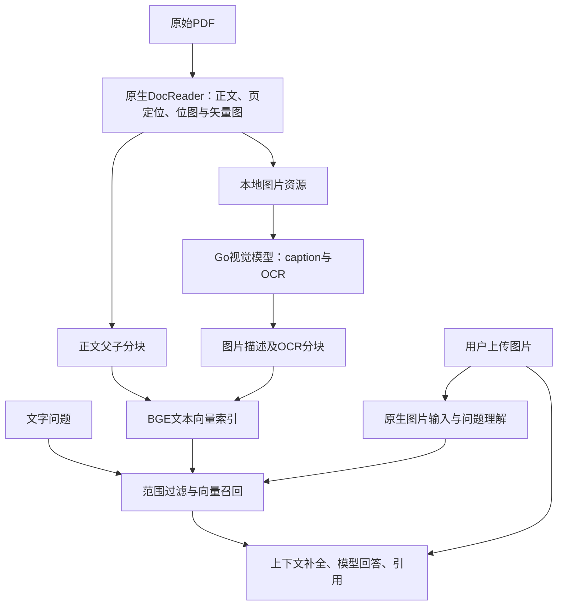

# 芯片手册图片问答：原生配置与实测

验证日期：2026-11-01，WSL Ubuntu 24.04 / Linux Docker Engine，网页 http://localhost:18088 。本轮只调整 Compose、部署环境和项目 HTTP API 中的模型、知识库、助手配置，没有修改 WeKnora 源码，也没有修改已有 Python 适配服务。

## 使用入口与验收结论

登录账号 `admin@weknora.local`，密码见本机 `.local/login.json`。左侧“智能体”选择 **芯片图文问答助手**，点击输入框的图片图标上传 PNG/JPEG 后提问；也可以直接指定手册、章节或图号提问。原有“芯片手册研读助手”和“STM32千页手册研读助手”仍可用于跨章节查阅。

以下对话均已保留，可直接打开：

| 验证 | 对话 | 结果 |
| --- | --- | --- |
| 上传电路图与时序图，包含网页原生上传复测 | [图片实测](http://localhost:18088/platform/chat/6834836a-7695-4f4a-8630-b2910104298e) | 两种图均能直接识别；末两轮使用原生配置直连 Go |
| 不上传图片，从入库电路图取证 | [CH340电路图检索](http://localhost:18088/platform/chat/68454a5c-1b48-4119-aca8-d18f1562c54b) | 正确识别型号、电容、发送链路，附图片描述分块引用 |
| 不上传图片，从入库时序图取证 | [W25Q32时序图检索](http://localhost:18088/platform/chat/64e4eb6d-a1c0-4be0-bcba-11a3e1283d9d) | 正确回答命令、地址、dummy、数据起始、高阻及折行关系，附OCR/描述引用 |

这些是两个样本的功能验收，不能推广为所有电路图、所有芯片手册的识别准确率。

## 模型与配置

采用 OpenCode Go 的 `deepseek-v4.1-flash`。现场 `/models` 元数据声明支持文本和 JPEG/PNG/GIF/WebP 图片输入，且实际携图调用成功；不是仅凭模型名称或设置一个开关推定视觉能力。元数据留在 `evidence/vision/live-go-model-metadata.json`。

项目中分别登记了对话模型和 VLLM，均通过原生 OpenAI 兼容客户端连接 `https://opencode.ai/zen/go/v1`：

- 对话模型 `3cd3f67f-fc74-4c06-8eb8-06612b43a09d`，登记 `supports_vision=true`、上下文 1M。
- 视觉解析模型 `45424fd2-52b0-4084-b62f-cff1a97298c8`，同一个 Go 模型，供图片理解、描述及OCR调用。
- 自定义请求头为 `User-Agent` 与 `x-opencode-session`。密钥通过项目已有 `/models/:id/credentials` 写入加密凭据存储；脱敏证据不含密钥。
- 模型 Spec 使用 `openai-completions`、`max_tokens` 与 `thinking-type` 兼容配置。批量描述/OCR使用原生 pipeline 参数关闭 thinking，避免推理占用解析输出预算。对话助手保留低强度推理。
- WSL 网络中域名解析会进入代理使用的特殊地址段，因此通过系统已有 SSRF 白名单配置只加入 `opencode.ai`，未关闭 SSRF 检查。
- 图片上传已在助手启用，绑定 VLLM，图片存储为项目原生 `local`。

原本的 18083 本地服务仍用于 BGE 文本 embedding。最终对话和视觉请求直接走 Go；没有为了视觉功能修改转发器。

## 原生解析、图片存储与入库结果

之前的轻量 HTTP PDF 适配器没有返回图片，不能靠打开知识库开关补回图片。本轮将实际解析地址切到官方 **DocReader gRPC 服务** `docreader:50051`，使用与 app 同批构建的官方镜像并固定摘要。`compose.yaml` 中启用内嵌图片提取与 PDF 矢量图渲染。DocReader 和 app 共享临时图片卷，app 以只读方式读取；DocReader 不暴露到宿主公网。

仅重解析 CH340C 和 W25Q32JVSSIQ 两份代表手册，其余八份资料保持原有文本索引。知识库启用多模态，使用项目自带 `default` 图片 pipeline，运行描述与OCR，再通过 BGE 建立文字向量。最终有效解析为 attempt 7；此前调试轮次的超时、截断与已取消任务不计入最终成功结果。

| 指标 | CH340C.pdf | W25Q32JVSSIQ.pdf |
| --- | ---: | ---: |
| DocReader 发现图片 | 11 | 74 |
| 去重后参与图片处理 | 11 | 66 |
| image_caption 分块 | 11 | 66 |
| image_ocr 分块 | 11 | 63 |
| 无可识别文字的OCR | 0 | 3（正常跳过） |
| 最终解析状态 | completed | completed |
| 最终 trace 失败节点 | 0 | 0 |
| 最终整轮耗时 | 18.531秒 | 99.462秒 |

图片画廊合计77张。W25中矢量时序图通过渲染也进入处理链，不限于PDF中已有的位图。耗时是本次现场结果，受并发、网络和服务负载影响。

证据：`evidence/vision/index-summary.json`、`gallery-final.json`、各文档 `*-stages.json` 与 `*-image-chunks.json`。早期调试 trace 单独归档，不应当作现状。

## 电路图：核对内容与结果

样本为 CH340C.pdf 第7页7.2节 USB 转 RS232 图。虽然文件名是 CH340C，图中实际画的是 **CH340G**。同时使用整页图与从原PDF提取的原始嵌入图，人工放大核对。

| 核对项 | 原图事实及最终结果 |
| --- | --- |
| U4、U5 | CH340G、MAX232 |
| X4 | 12MHz |
| C21、C22 | 各33pF |
| C25～C29 | 各0.47μF |
| 发送路径 | U4 TXD第2脚 → U5 T1I第11脚 → T1O第14脚 → DB9第3脚 |
| 接收路径（上传整页测试） | DB9第2脚 → U5 R1I第13脚 → R1O第12脚 → U4 RXD第3脚 |

上传整页首次回答通过；网页上传原始小图再次正确读出型号、C29与发送路径。无上传检索回答也正确引用图片描述分块。不能把识别结果理解成程序已经生成了严格的电气网表。

质检中发现两类值得保留的记录：第一，人工一度把整页缩放预览中的C29误读为0.1μF；从PDF提取原图放大后确认是0.47μF，模型首次此项正确，基准已修正。第二，入库的自动描述存在个别脚名/连接转写错误，例如把R1O写作R10、对TX/RX关系描述不严谨。最终问答这几个核对项正确，不代表全部自动描述都准确；关键连接应回看原图。

## 时序图：核对内容与结果

样本为 W25Q32JVSSIQ.pdf 的PDF第29页（印刷页28），Figure 16 Fast Read Instruction。

| 核对项 | 原图事实及最终结果 |
| --- | --- |
| 命令 | 0Bh，CLK0～7 |
| 地址 | 24位，A23～A0，CLK8～31 |
| Dummy | 8个时钟，CLK32～39 |
| 首数据字节 | CLK40～47，MSB先出 |
| 下一字节 | CLK48～55 |
| Dummy期间DO | 图示High Impedance（高阻） |
| 上下两行 | 同一次/CS低有效事务；CLK31在折行处重复以表示衔接 |

首次上传回答中，命令、位数、dummy和数据起始正确，但额外解释曾把下半行说成“重新拉低片选”。针对图中CLK31/32及/CS线复核后正确；随后网页原生上传复测，以及无上传入库检索均正确回答连续事务。已在助手提示中要求检查折行编号、只回答所问，仍不保证消除所有误读。图示高阻与正文“don't care”含义有区别，不能在电气设计中将二者视作普遍等价关系。

## 两条问答链路及能力边界

**上传图片**：原生界面接收图片，项目进行图片输入校验、存储、视觉问题理解，再检索手册。支持视觉的最终对话模型也收到图片；网页两轮上传已验证，原生模型debug接口另用原始电路图读取C29成功。

**文字查询入库图片**：先在入库阶段让VLM读图，把描述和OCR变成可检索文字。查询命中相关分块后，模型利用这些文字与正文回答并给出分块引用。两例均未携带上传图片，引用中实际出现 `image_caption`、`image_ocr`。

**当前没有开启图片向量检索**：BGE-small-zh-v1.5是文本embedding。开启多模态解析和视觉对话，并不让BGE具备图片embedding能力。运行日志明确显示 `image_recall_enabled=false`；因此这两例入库检索不能声称“凭图像向量命中原图并让模型重新看图”。描述/OCR遗漏的细小边沿、连线、图例可能仍然答错或答不出，此时可把相关页/图上传给图文助手直接核对。

当前检出的源码还包括按图像向量证据回附原图的分支，涉及 `internal/searchutil/image_evidence.go` 和 `chat_pipeline/into_chat_message.go`；那条分支要求真实图片embedding和检索证据。不能将源码可选功能等同于本部署已运行功能，也不能把较新源码全部能力归到当前固定的f17官方镜像。

SQLite官方镜像仍缺FTS5，当前有效召回以文字向量为主；未新增重排模型、图谱、图片embedding或专用电路拓扑解析器。

## 千页、跨页和跨章节的含义

此前1749页STM32 RM0090已完成原生研读验证，详见 `docs/knowledge-qa-analysis.md`。本轮没有把1749页全部重新做视觉解析；77张图的成功不能证明千页扫描件已全部验收。

跨页并不是模型一次吞下整本PDF：正文保留页码/定位，父子分块提高召回粒度与邻近上下文完整性；跨章节问题由检索召回多处证据，或由原生研读助手调用文档列表/分块阅读工具分次取证，再汇总并引用。章节关联来自问题、分块内容、文档身份与模型推理，当前没有预先构建完整电路知识图谱。

图像跨页同样受召回覆盖限制。若时序图分散在不同页，必须同时取到相应的描述/OCR或把两页原图上传；页码邻近、章节标题相同不会自动证明它们属于同一事务。复杂问题建议明确芯片版本、图号及章节，并使用研读助手查文字证据、图文助手核对关键图面。

大量图像会增加解析、VLM调用、存储和索引成本；本次DocReader配置并发2、单文件50MB，模型并发4。Go模型1M上下文也不意味着系统会把千页及所有图片一次发送。对超大文件、长批次及高负载，应按项目现有解析限制、任务状态和模型额度逐项确认。

## 本轮可复核文件

- `compose.yaml`：原生DocReader、共享临时卷、固定镜像与健康检查。
- `.local/weknora.env`：gRPC地址和并发配置；`.local/knowledge-state.json`：模型、助手及示例对话ID。
- `evidence/vision/ground-truth.json`：人工核对基准。
- `evidence/vision/circuit-qa.json`、`timing-qa.json`、`timing-recheck.json`：首次与复核结果，保留误读记录。
- `evidence/vision/circuit-indexed-qa.json`、`timing-indexed-qa.json`：无上传图像的RAG结果及引用。
- `evidence/vision/browser-circuit.png`、`browser-timing.png`：网页原生上传结果。
- `evidence/vision/native-vlm-debug.json`：原生VLLM接口携图调用成功。

完成后已检查官方 app、DocReader 健康，前端可访问；`git -C WeKnora status --short`为空。本地已有的适配服务代码也未作修改。
